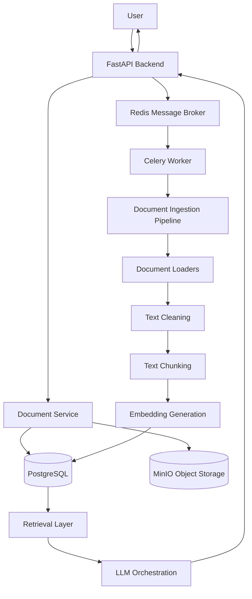
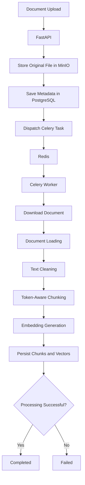

# DocuMind AI

**An intelligent document knowledge assistant powered by Retrieval-Augmented Generation (RAG).**

DocuMind AI is a document intelligence platform designed to transform unstructured documents into searchable, context-aware knowledge. It combines document processing, semantic embeddings, vector storage, and language models to enable users to retrieve relevant information and interact with their documents.

The project follows a modular architecture that separates document ingestion, storage, retrieval, and language model orchestration.

> **Project status:** Active development. The document ingestion pipeline and asynchronous processing workflow are implemented and integration-tested. Retrieval, generation, and the complete conversational interface are under development.

---

## Table of Contents

- [Overview](#overview)
- [Architecture](#architecture)
- [Document Ingestion Pipeline](#document-ingestion-pipeline)
- [Technology Stack](#technology-stack)
- [Project Structure](#project-structure)
- [Getting Started](#getting-started)
- [Environment Configuration](#environment-configuration)
- [Running the Application](#running-the-application)
- [API Endpoints](#api-endpoints)
- [Testing](#testing)
- [Development Roadmap](#development-roadmap)

---

## Overview

DocuMind AI aims to provide a unified interface for managing documents and extracting knowledge from them.

The platform is designed around the following capabilities:

- **Document ingestion:** Upload and process PDF, DOCX, and TXT documents.
- **Asynchronous processing:** Execute computationally intensive ingestion tasks using Celery and Redis.
- **Text extraction and cleaning:** Extract structured text and normalize extracted content.
- **Intelligent chunking:** Split documents into token-aware chunks while preserving page references.
- **Semantic embeddings:** Generate multilingual vector representations using Sentence Transformers.
- **Vector storage:** Store document chunks and embeddings in PostgreSQL with pgvector.
- **Semantic retrieval:** Retrieve relevant document passages using vector similarity.
- **Context-aware generation:** Use retrieved document context to support LLM-generated responses.

The architecture is modular, allowing individual components to evolve independently.

## Architecture

The platform follows a modular, service-oriented architecture.

### High-Level Architecture



*The diagram represents the intended architecture. Retrieval and LLM integration are still under development.*

### Storage Architecture

DocuMind AI separates binary document storage from structured metadata and vector data.

| Component | Responsibility |
|---|---|
| PostgreSQL | Document metadata, processing status, and chunk records |
| pgvector | Storage and similarity search of embedding vectors |
| MinIO | Original document storage |
| Redis | Celery message broker and task result backend |

This separation allows document files and searchable representations to be managed independently.

## Document Ingestion Pipeline

The ingestion pipeline is responsible for transforming uploaded documents into searchable vector representations.

### Processing Workflow



### 1. Document Upload

The FastAPI backend accepts document uploads and validates the supported file formats.

Supported formats:

- PDF
- DOCX
- TXT

Original documents are stored in MinIO, while their metadata and storage references are persisted in PostgreSQL.

### 2. Asynchronous Processing

Document processing is delegated to Celery workers through Redis.

This prevents computationally intensive operations such as text extraction, chunking, and embedding generation from blocking the upload request.

Document processing statuses:

| Status | Description |
|---|---|
| `uploaded` | Document successfully uploaded and registered |
| `queued` | Processing task submitted to Celery |
| `processing` | Worker is processing the document |
| `completed` | Ingestion successfully completed |
| `failed` | Processing encountered an error |

### 3. Text Extraction

Dedicated loaders handle document extraction:

- PDF: PyMuPDF
- DOCX: python-docx
- TXT: UTF-8 text extraction

Extracted content is represented using a common document structure that preserves page references where available.

### 4. Text Cleaning

The cleaning module normalizes extracted content before chunking.

Implemented cleaning operations include Unicode normalization, whitespace normalization, line-ending normalization, and removal of unwanted control characters.

Additional cleaning components are organized separately for future processing improvements.

### 5. Token-Aware Chunking

Documents are divided into smaller, overlapping text segments.

The chunking implementation uses the tokenizer associated with the embedding model to control chunk sizes and preserve contextual overlap.

Current default configuration:

| Parameter | Value |
|---|---:|
| Chunk size | 500 tokens |
| Chunk overlap | 100 tokens |
| Embedding model | `intfloat/multilingual-e5-small` |
| Embedding dimension | 384 |

Page references and chunk metadata are preserved for downstream retrieval and source attribution.

### 6. Embedding Generation

Semantic embeddings are generated using Sentence Transformers.

Model: [`intfloat/multilingual-e5-small`](https://huggingface.co/intfloat/multilingual-e5-small)

The implementation uses:

- `passage:` prefix for document chunks.
- Batch embedding generation.
- L2-normalized embeddings.
- 384-dimensional vectors.
- Automatic CPU/GPU device selection.

### 7. Vector Persistence

Generated chunks and embeddings are stored in PostgreSQL using pgvector.

The database supports vector similarity search through an HNSW index configured with cosine distance.

---

## Technology Stack

| Category | Technologies |
|---|---|
| Programming Language | Python |
| Backend API | FastAPI |
| Asynchronous Processing | Celery |
| Message Broker | Redis |
| Relational Database | PostgreSQL |
| Vector Database Extension | pgvector |
| Object Storage | MinIO |
| Document Processing | PyMuPDF, python-docx |
| Text Processing | Hugging Face Transformers |
| Embedding Generation | Sentence Transformers |
| Embedding Model | multilingual-e5-small |
| Testing | pytest |
| Containerization | Docker, Docker Compose |
| Frontend | Streamlit (development scaffold) |

---

## Project Structure

```text
documind-ai/
│
├── backend/
│   └── app/
│       ├── api/
│       │   └── v1/
│       │       ├── chat.py
│       │       ├── documents.py
│       │       ├── health.py
│       │       └── knowledge_bases.py
│       ├── core/
│       │   ├── config.py
│       │   └── logging.py
│       ├── dependencies/
│       ├── schemas/
│       ├── services/
│       │   └── document_service.py
│       └── main.py
│
├── database/
│   ├── migrations/
│   │   ├── 001_enable_pgvector.sql
│   │   └── 002_create_document_tables.sql
│   ├── models/
│   ├── repositories/
│   │   ├── chunk_repository.py
│   │   └── document_repository.py
│   └── migrations.py
│
├── docs/
├── evaluation/
│
├── frontend/
│   └── streamlit_app.py
│
├── infra/
│   ├── minio/
│   │   ├── policies/
│   │   └── init.sh
│   ├── postgres/
│   │   └── postgres_client.py
│   └── storage/
│       └── minio_client.py
│
├── ingestion/
│   ├── chunking/
│   ├── cleaning/
│   ├── embeddings/
│   ├── loaders/
│   ├── parsers/
│   └── pipeline.py
│
├── llm/
│   ├── prompts/
│   ├── client.py
│   └── generation.py
│
├── retrieval/
│   ├── context_builder.py
│   ├── filters.py
│   ├── reranker.py
│   └── vector_search.py
│
├── scripts/
│   └── test_document_upload.py
│
├── tests/
│   ├── integration/
│   ├── test_chunk_repository/
│   ├── test_chunking/
│   ├── test_cleaning/
│   ├── test_embeddings/
│   ├── test_ingestion/
│   ├── test_loaders/
│   ├── test_document_repository.py
│   ├── test_document_service.py
│   ├── test_minio_client.py
│   └── test_postgres_client.py
│
├── worker/
│   ├── celery_app.py
│   └── tasks.py
│
├── .env.example
├── .gitignore
├── docker-compose.yml
├── Makefile
├── pyproject.toml
└── README.md
```

---

## Getting Started

### Prerequisites

Make sure you have the following installed:

- Python 3.11+
- Git
- Docker Engine
- Docker Compose
- GNU Make
- MinIO Client (`mc`)

#### Install MinIO Client (`mc`)

The MinIO Client is used by the project initialization script to configure and manage MinIO resources.

For Linux / WSL Ubuntu:

```bash
curl https://dl.min.io/client/mc/release/linux-amd64/mc \\
  --create-dirs \\
  -o ~/minio-binaries/mc

chmod +x ~/minio-binaries/mc
sudo mv ~/minio-binaries/mc /usr/local/bin/mc
```

Verify the installation:

```bash
mc --version
```

### 1. Clone the Repository

```bash
git clone <YOUR_REPOSITORY_URL>
cd documind-ai
```

### 2. Create a Virtual Environment

```bash
python3 -m venv .documind-ai
source .documind-ai/bin/activate
```

### 3. Install Dependencies

```bash
pip install --upgrade pip
pip install -e ".[dev]"
```

The `dev` optional dependency group is defined in `pyproject.toml` and installs the development tools (`pytest`, `httpx`, and `ruff`).

### 4. Configure Environment Variables

Create your local environment file:

```bash
cp .env.example .env
```

Update the values according to your local environment.

See [Environment Configuration](#environment-configuration).

### 5. Initialize and Start Infrastructure Services

Use the Makefile targets to initialize each service. These commands start the corresponding Docker Compose service and wait for readiness where applicable.

**PostgreSQL**

```bash
make db-init
```

This starts PostgreSQL, waits until it is ready, and automatically runs the pending SQL migrations. There is no need to run `make db-migrate` separately during initial setup.

**MinIO**

```bash
make minio-init
```

This runs `infra/minio/init.sh`, which performs the first-time MinIO initialization. Make sure `mc` is installed and available in your `PATH`.

**Redis**

```bash
make redis-init
```

This starts Redis and waits until it responds to the health check.

Check service status:

```bash
make db-status
make minio-status
make redis-status
```

The MinIO web console is available at:

```text
http://localhost:9001
```

You can open it using:

```bash
make minio-console
```

---

## Environment Configuration

DocuMind AI uses environment variables for infrastructure and application configuration.

The `.env.example` file provides the configuration template.

The main configuration categories include:

| Category | Variables |
|---|---|
| PostgreSQL | `POSTGRES_HOST`, `POSTGRES_PORT`, `POSTGRES_DB`, `POSTGRES_USER`, `POSTGRES_PASSWORD` |
| MinIO | `MINIO_ENDPOINT`, `MINIO_ACCESS_KEY`, `MINIO_SECRET_KEY`, `MINIO_BUCKET` |
| Redis | `REDIS_URL` |
| Embeddings | `EMBEDDING_MODEL` |
| Application | API and upload configuration |

Use the exact variable names and defaults defined in `.env.example` and the application configuration.

**Never commit `.env` or expose production credentials.**

---

## Infrastructure Management

The Makefile provides shortcuts for managing the infrastructure services.

### PostgreSQL

| Command | Description |
|---|---|
| `make db-init` | Start PostgreSQL, wait for readiness, and apply migrations |
| `make db-start` | Start PostgreSQL |
| `make db-stop` | Stop PostgreSQL while preserving data |
| `make db-restart` | Restart PostgreSQL |
| `make db-status` | Show PostgreSQL container status |
| `make db-logs` | Follow PostgreSQL logs |
| `make db-shell` | Open the PostgreSQL shell |
| `make db-migrate` | Apply pending SQL migrations |
| `make db-down` | Stop PostgreSQL |

### MinIO

| Command | Description |
|---|---|
| `make minio-init` | Run the MinIO initialization script |
| `make minio-start` | Start MinIO |
| `make minio-stop` | Stop MinIO |
| `make minio-restart` | Restart MinIO |
| `make minio-status` | Show MinIO container status |
| `make minio-logs` | Follow MinIO logs |
| `make minio-console` | Open the MinIO web console |
| `make minio-down` | Stop MinIO |

### Redis

| Command | Description |
|---|---|
| `make redis-init` | Start Redis and wait for readiness |
| `make redis-start` | Start Redis |
| `make redis-stop` | Stop Redis |
| `make redis-restart` | Restart Redis |
| `make redis-status` | Show Redis container status |
| `make redis-logs` | Follow Redis logs |
| `make redis-shell` | Open the Redis CLI |
| `make redis-down` | Stop Redis |

### Celery Worker

| Command | Description |
|---|---|
| `make worker-start` | Start the Celery worker |
| `make worker-status` | Inspect active workers |

---

## Running the Application

DocuMind AI currently runs as separate API and worker processes.

### 1. Start FastAPI

```bash
uvicorn backend.app.main:app --reload
```

API base URL:

```text
http://localhost:8000
```

Interactive API documentation:

```text
http://localhost:8000/docs
```

### 2. Start the Celery Worker

In a separate terminal, activate the virtual environment and run:

```bash
source .documind-ai/bin/activate
make worker-start
```

The worker listens for document-processing tasks through Redis.

To check whether a worker is responding:

```bash
make worker-status
```

### 3. Upload and Track a Document

A test script is provided to validate the complete asynchronous ingestion workflow.

```bash
python scripts/test_document_upload.py /path/to/document.pdf
```

The script:

1. Uploads the document through FastAPI.
2. Receives the generated document ID.
3. Tracks the document status in PostgreSQL.
4. Waits until processing completes or fails.
5. Displays the final processing information.

Example output:

```text
[1/3] Uploading document...
Upload successful!
Initial status: queued

[2/3] Tracking document processing...
[   0.0s] Status: QUEUED
[   2.0s] Status: PROCESSING
[   6.0s] Status: COMPLETED

[3/3] Processing finished
Document: example.pdf
Status: COMPLETED
Pages: 1
Chunks: 2
Embedding model: intfloat/multilingual-e5-small
```

---

## API Endpoints

The API is organized under `/api/v1`.

| Method | Endpoint | Description |
|---|---|---|
| POST | `/api/v1/documents/` | Upload a document |
| GET | `/api/v1/health/live` | Check application liveness |
| GET | `/api/v1/health/ready` | Check application readiness |

Additional chat and knowledge-base route modules are part of the application structure and are under development.

For the complete available API documentation, visit:

`http://localhost:8000/docs`

---

## Testing

The project uses pytest for unit and integration testing.

### Run All Tests

```bash
python -m pytest -v
```

### Run Individual Test Suites

```bash
# Document loaders
python -m pytest tests/test_loaders/ -v

# Text cleaning
python -m pytest tests/test_cleaning/ -v

# Chunking
python -m pytest tests/test_chunking/ -v

# Embeddings
python -m pytest tests/test_embeddings/ -v

# Chunk repository
python -m pytest tests/test_chunk_repository/ -v

# Ingestion pipeline
python -m pytest tests/test_ingestion/ -v

# Document repository
python -m pytest tests/test_document_repository.py -v
```

### Integration Tests

Integration tests require running infrastructure services and a valid local environment configuration.

```bash
python -m pytest tests/integration/ -v -s
```

The ingestion integration test validates document retrieval from MinIO, real text extraction, chunking, embedding generation, and persistence in PostgreSQL.

The project has also been tested through a real upload-to-completion workflow using FastAPI, Redis, Celery, MinIO, and PostgreSQL.

---

## Development Roadmap

The project is being developed incrementally.

### Completed

- [x] Modular backend architecture
- [x] FastAPI document upload API
- [x] PostgreSQL integration
- [x] pgvector extension and database migrations
- [x] MinIO object storage integration
- [x] PDF, DOCX, and TXT document loaders
- [x] Text cleaning
- [x] Token-aware chunking
- [x] Multilingual embedding generation
- [x] Chunk and embedding persistence
- [x] Celery and Redis integration
- [x] Asynchronous document ingestion
- [x] Document processing status tracking
- [x] End-to-end upload and ingestion validation

### In Progress

- [ ] Vector similarity retrieval
- [ ] Metadata-based retrieval filters
- [ ] Context construction
- [ ] Document reranking
- [ ] LLM integration and prompt orchestration
- [ ] Conversational RAG API
- [ ] Streamlit frontend
- [ ] Retrieval and generation evaluation

### Future Improvements

- [ ] Hybrid search (vector + keyword retrieval)
- [ ] OCR support for scanned documents
- [ ] Advanced document structure and table extraction
- [ ] Improved ingestion recovery and retry mechanisms
- [ ] Retrieval quality evaluation and benchmarking
- [ ] Production observability and monitoring
- [ ] Authentication and multi-user knowledge-base management

---

## License

License information will be added when the project license is selected.

---

**DocuMind AI** — Turning documents into searchable knowledge.